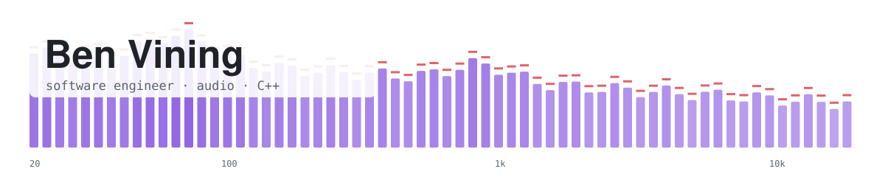

  <picture>
    <source media="(prefers-color-scheme: dark)" srcset="assets/header-spectrum-dark.svg">
    
  </picture>

  I write C++ for the audio industry, mostly as an independent contractor: plugins, desktop apps, and the build systems &amp; CI that ship them. Six years in, based in Chicago. 
  <a href="https://linkedin.com/in/ben-vining-264377242">LinkedIn</a> ·
  <a href="https://benvining.bandcamp.com">Music</a> ·
  <a href="https://www.youtube.com/channel/UCQCxlghSGAa9BYdSciCPoQQ">YouTube</a>

  
  
  
  
  
  
  
  

### Now

<table>
<tr>
<td width="50%" valign="top">

**CarbonQ** · [Mastering The Mix](https://www.masteringthemix.com)

A mastering EQ plugin. The instances on each bus talk to each other to recreate the tonal balance of a reference mix.

`released Oct 2026` `~1,800 licenses`

</td>
<td width="50%" valign="top">

**EQ Academy** · [Mastering The Mix](https://www.masteringthemix.com)

A free, game-like desktop app that teaches EQ by altering a reference mix and scoring you on recreating the original.

`released Jul 2025` `~20,000 users`

</td>
</tr>
</table>

I'm the sole developer on both. They're built on a shared C++ framework I designed for the product line (inter-plugin communication, instance registration and a shared UI component system).

### Projects

<table>
<tr>
<td width="33%" valign="top">

[**BenBot**](https://github.com/benthevining/BenBot) 
UCI chess engine in C++23. Magic bitboards, threaded search, SPRT tested. Around 1700-1800 Elo.

</td>
<td width="33%" valign="top">

[**linfra**](https://github.com/benthevining/linfra) 
Shared CMake infrastructure for cross-compiling & testing C++ on desktop, mobile and WebAssembly.

</td>
<td width="33%" valign="top">

[**plugin-cancellation-testing**](https://github.com/benthevining/plugin-cancellation-testing) 
CMake module that registers audio cancellation tests for plugins with CTest.

</td>
</tr>
</table>

### Clients

[Leapwing Audio](https://www.leapwingaudio.com) · iZotope (via Fielding DSP) · [Code Garden / Node Audio](https://node.audio) · InMusic Brands · [Foleys Finest Audio](https://foleysfinest.com) · reFX · Melatonin · Audioloom

<b>Background</b>

 

I studied music composition at Arizona State, and spent a few years in professional theatre as a stage manager and lighting technician. I got into code through electronic music: I built my own instruments & effects in Max/MSP, then moved to C++ when I needed more control. At some point I stopped being a musician who wrote a bit of code and became a programmer.

I still make music now and then: [Bandcamp](https://benvining.bandcamp.com) · [Spotify](https://open.spotify.com/artist/2UA73qR4E3nNPjjf8CphX8) · [SoundCloud](https://soundcloud.com/benvining)

